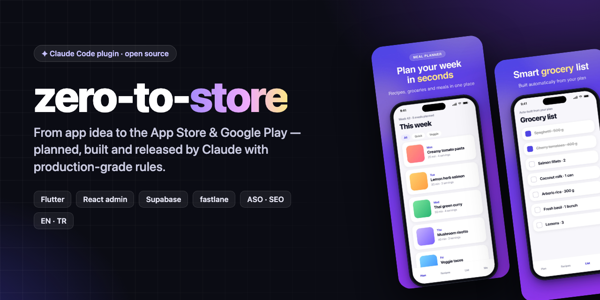
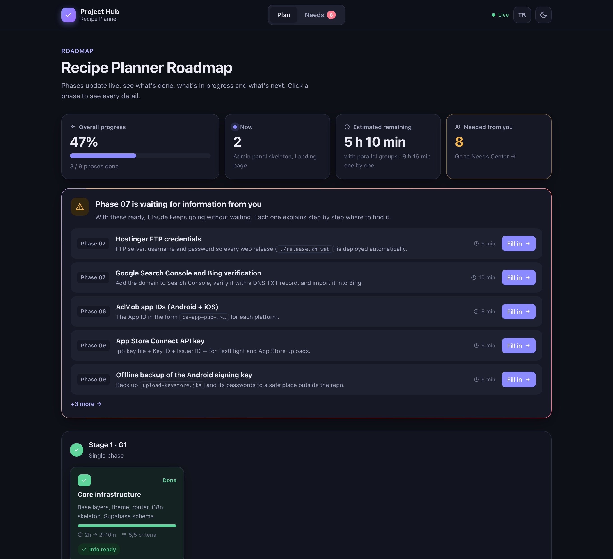
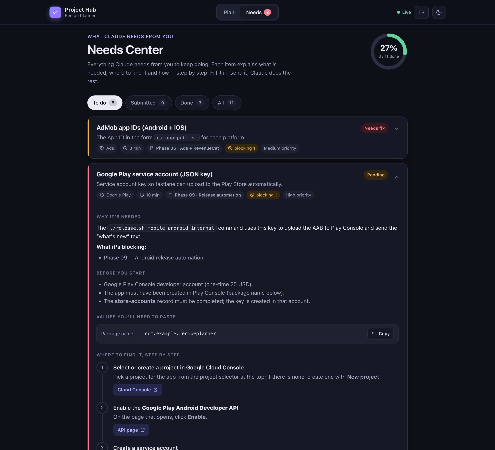
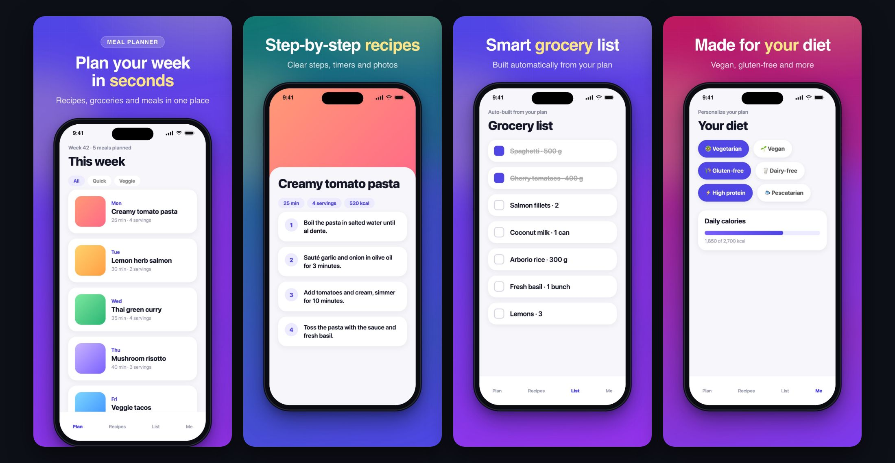

<p align="center">
  
</p>

<p align="center">
  <a href="https://github.com/alidemirci2307/zero-to-store/releases"></a>
  <a href="https://github.com/alidemirci2307/zero-to-store/actions/workflows/ci.yml"></a>
  <a href="LICENSE"></a>
  
  
</p>

<p align="center"><b>English</b> · <a href="README.tr.md">Türkçe</a></p>

**zero-to-store** is a Claude Code plugin that takes a mobile app idea all the
way to the App Store and Google Play. Claude plans the product in phases,
builds a Flutter app, a React admin panel, a Supabase backend and a landing
page in parallel, and ships it with fully automated, multi-language store
releases. The rule set behind it is opinionated and production-grade. You
watch everything live in a local **Project Hub**.

## Why

- **One command to kickoff.** `/zero-to-store:kickoff <your idea>`. Claude asks
  every question up front once, then works through the whole plan without
  stopping.
- **Rules that ship apps.** Clean Architecture, 300-line file limit, i18n from
  day one, offline states, force update, account deletion, ATT + UMP consent,
  privacy manifests and store data-safety answers.
- **ASO and SEO built in.** Keyword research, app names checked for uniqueness
  in both stores, metadata limits validated for every locale, and modern store
  screenshots generated automatically in every language.
- **Releases on autopilot.** Play internal + closed testing and a TestFlight
  "testers" group. Test builds are promoted to production without a rebuild.
  Every release is a git tag plus a GitHub Release backup.
- **Never the wrong account.** Store accounts are confirmed once. Claude stops
  and asks when a console shows several accounts, and releases abort if the API
  keys belong to another account.
- **It keeps working after launch.** An optional daily routine watches
  crashes, Play vitals, reviews and ASO ranks. It fixes data-proven problems,
  ships them to the test tracks first and halts a staged rollout on a crash
  spike. You follow it in the Project Hub's Operations tab.
- **You always know what's going on.** The Project Hub shows the roadmap live
  and lists exactly what Claude needs from you, with step-by-step instructions
  to find each item.

## Screenshots

**Project Hub — live roadmap**



**Needs Center — what Claude needs from you, and where to find it**



**Store screenshots — generated for every language and store size**



## Quick start

Install as a Claude Code plugin:

```text
/plugin marketplace add alidemirci2307/zero-to-store
/plugin install zero-to-store@zero-to-store
```

Then open an empty folder and describe your app:

```text
/zero-to-store:kickoff A meal-planning app: weekly plans, recipes, an auto grocery list, premium without ads
```

Other ways to install:

- **Shell:** `claude plugin marketplace add alidemirci2307/zero-to-store && claude plugin install zero-to-store@zero-to-store`
- **skills.sh:** `npx skills add alidemirci2307/zero-to-store`
- **Manual:** clone the repo and run `./install.sh` (personal) or `./install.sh --project`

## How it works

1. **Skeleton.** A monorepo (`apps/mobile`, `apps/panel`, `apps/web`, shared
   `supabase/`), CLAUDE.md, the rules and the Project Hub are created and
   committed, and a private GitHub repo is connected.
2. **Tool check.** Supabase MCP, Firebase CLI, Chrome MCP and RevenueCat MCP are
   checked; anything missing is requested.
3. **All questions at once.** Web presence, languages, ad and push strategy,
   ASO/SEO keywords, and app/package name candidates checked in both stores.
   Secrets are never asked in chat; they go through the Needs Center.
4. **Plan.** Detailed phases with a dependency graph and parallel groups.
   Every foreseeable external need is opened in the Needs Center right away.
5. **Build.** Phases run on parallel subagents. Each group ends with
   integration and a rule audit, and progress shows up live in the Project
   Hub.
6. **Release.** `./release.sh mobile all internal` → test →
   `./release.sh mobile all promote`. Web and admin deploy by tag:
   `./release.sh web`.
7. **Operate (optional).** A local daily routine checks stability, reviews
   and ASO, writes a report and sends a short summary. Its autonomy level
   is your choice; the default ships fixes only to the test tracks.

## What's inside

| Part | What it does |
|---|---|
| `skills/zero-to-store/references/rules.md` | 18-section rule set (English; `rules.tr.md` Turkish, kept in sync by CI) |
| `assets/repo/` | Monorepo skeleton: `release.sh`, release scripts, CI on changed apps, tag-triggered deploys, pnpm workspace |
| `assets/project-hub/` | Dependency-free local web app: live roadmap + Needs Center (EN/TR UI) |
| `assets/store-screenshots/` | Flutter capture per locale × device + framed renders at exact store sizes |
| `assets/templates/` | Fastfile with metadata/ASO validation, CLAUDE/PLAN/PHASE/TODO templates (EN + TR) |
| `commands/kickoff.md` | The `/zero-to-store:kickoff` command |

## Release commands (in your project)

| Command | Result |
|---|---|
| `./release.sh mobile all internal` | Play internal + closed testing, TestFlight "testers" group, tag `mobile/vX.Y.Z`, pre-release with AAB/IPA |
| `./release.sh mobile all promote` | The same tested build goes to production (staged on Play, App Store review) |
| `./release.sh web` / `./release.sh panel` | Tag `web/vX.Y.Z` → CI deploys and attaches `dist.zip` |
| `./release.sh changes mobile` | Commits, file summary and notes between the last two versions |
| `./release.sh rollout 0.5` / `./release.sh halt` | Widen the Play staged rollout, or halt it and pause the iOS phased release |

## Requirements

- Claude Code (Opus or Sonnet), Node 18+, Git, GitHub CLI
- For mobile: Flutter, Xcode (iOS), Android SDK, Ruby + Bundler (fastlane)
- Google Chrome (store screenshot rendering)
- Apple Developer and Google Play Console accounts when you publish

## Updating

New versions are announced in [Releases](https://github.com/alidemirci2307/zero-to-store/releases)
and [CHANGELOG.md](CHANGELOG.md). Update with:

```text
claude plugin update zero-to-store@zero-to-store
```

Or turn on auto-update: `/plugin` → Marketplaces → zero-to-store → Enable auto-update.
Existing projects keep their own copy of the rules (`docs/RULES.md`). Ask
Claude to "sync docs/RULES.md with the latest zero-to-store rules" to upgrade
one.

## FAQ

- **Does it work in other languages?** Claude talks to you in your language.
  Rules and templates ship in English and Turkish; project docs follow the
  project language.
- **Do I need every part?** No. Only the apps you ask for are created; no web
  presence means no `apps/web` and no web workflow.
- **Where do my keys go?** Into `hub/inbox/` on your machine (never committed).
  Claude moves each value to its target (env, GitHub Secrets, `fastlane/keys/`)
  and then deletes it from the inbox.

## Contributing

Issues and pull requests are welcome — see [CONTRIBUTING.md](CONTRIBUTING.md).
Rule changes must be made in both `rules.md` and `rules.tr.md`; CI checks that
their structure matches.

## License

[MIT](LICENSE) © Ali Demirci. If zero-to-store saves you time, a ⭐ helps others find it.
