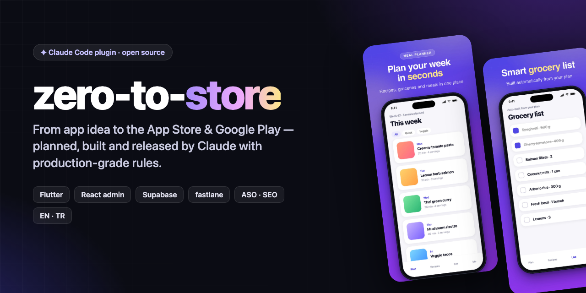
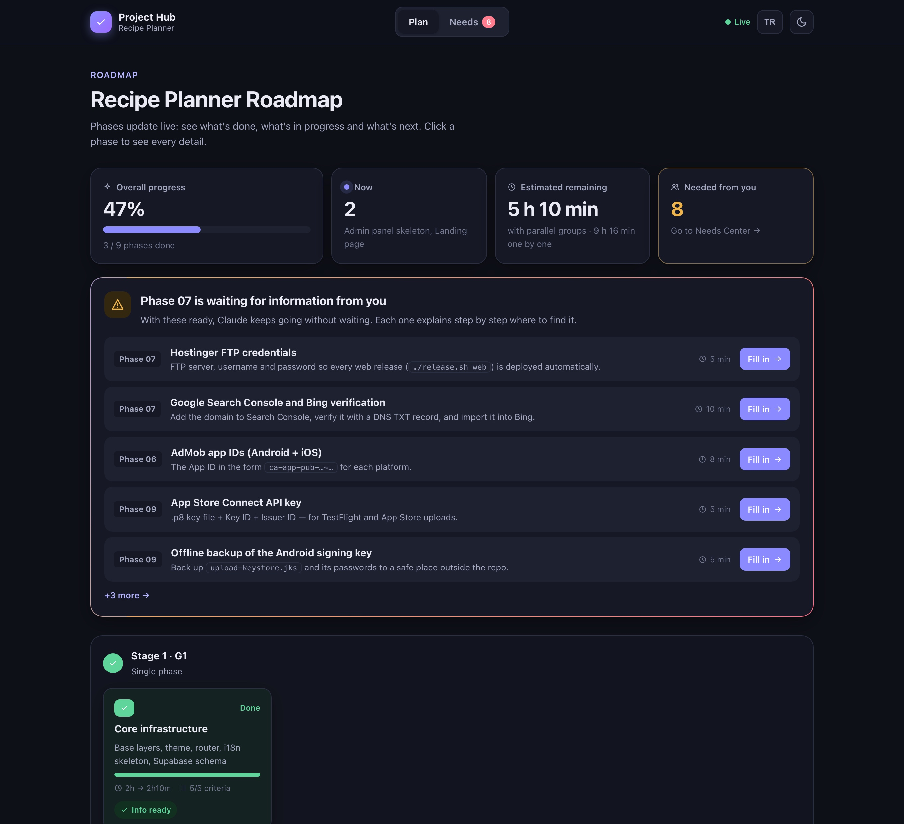
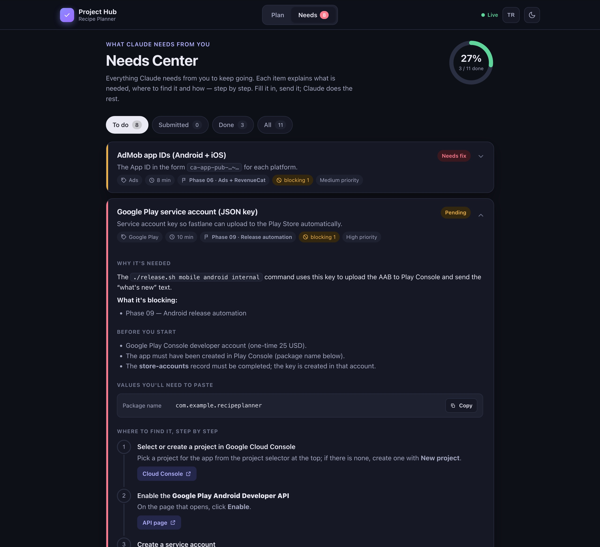
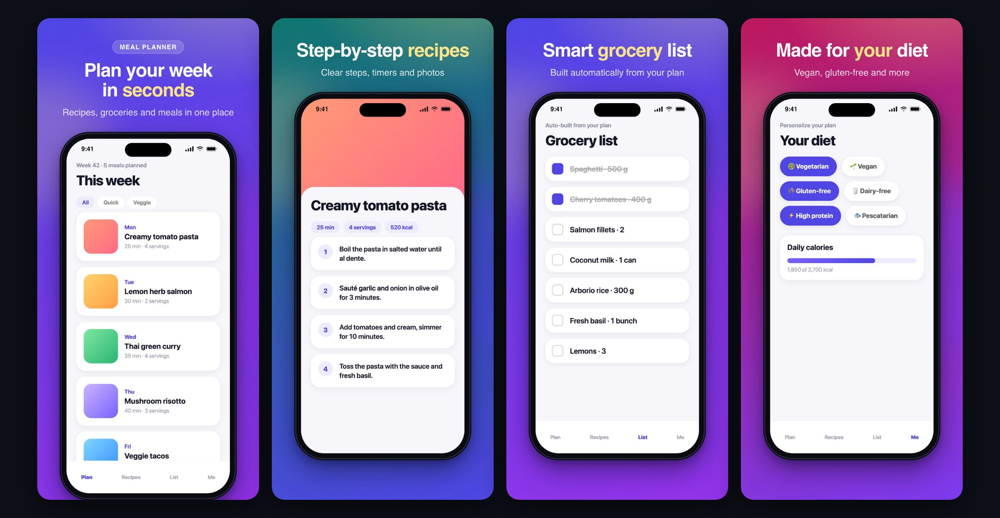

<p align="center">
  
</p>

<p align="center">
  <a href="https://github.com/alidemirci2307/zero-to-store/releases"></a>
  <a href="https://github.com/alidemirci2307/zero-to-store/actions/workflows/ci.yml"></a>
  <a href="LICENSE"></a>
  
  
</p>

<p align="center"><b>English</b> · <a href="README.tr.md">Türkçe</a></p>

**zero-to-store** is a Claude Code plugin that takes a mobile app idea all the
way to the App Store and Google Play. Claude interviews you about the
product, plans it in phases, designs it with you in Claude Design, builds a
Flutter app with the backend, admin panel and website you chose in parallel,
and ships it with fully automated, multi-language store releases. The rule set behind it is opinionated and production-grade. You
watch everything live in a local **Project Hub**.

## Why

- **A real kickoff interview.** `/zero-to-store:kickoff <your idea>`. Claude
  asks the critical questions in a few adaptive rounds, each with a
  recommended best-practice answer, and skips whatever your earlier answers
  ruled out. Then it works through the whole plan without stopping, or
  checks in with you between phases if you prefer.
- **Your stack, your call.** Supabase Cloud, self-hosted Supabase on your own
  server, Firebase or no backend at all; Hostinger, Firebase Hosting,
  Cloudflare Pages or your own server. Firebase Analytics and Crashlytics are
  always in.
- **Designed before it's coded.** With Claude Design, every screen is
  designed in Claude for you to review and approve: a rich animated
  onboarding, a store-compliant paywall, ad placements, every state, light
  and dark.
- **Rules that ship apps.** Clean Architecture, 300-line file limit, i18n from
  day one, offline states, force update, account deletion, ATT + UMP consent,
  privacy manifests and store data-safety answers.
- **ASO and SEO built in.** Keyword research, app names checked for uniqueness
  in both stores, metadata limits validated for every locale, and modern store
  screenshots generated automatically in every language.
- **Releases on autopilot.** Play internal + closed testing and a TestFlight
  "testers" group. Test builds are promoted to production without a rebuild.
  Every release is a git tag plus a GitHub Release backup.
- **Never the wrong account.** Store accounts are confirmed once. Claude stops
  and asks when a console shows several accounts, and releases abort if the API
  keys belong to another account.
- **It keeps working after launch.** An optional daily routine watches
  crashes, Play vitals, reviews and ASO ranks. It fixes data-proven problems,
  ships them to the test tracks first and halts a staged rollout on a crash
  spike. You follow it in the Project Hub's Operations tab.
- **Claude does the legwork.** Console setup runs through CLIs, MCPs and your
  signed-in browser. Keys go from a download or the clipboard straight into a
  local inbox, never through the chat. Only what truly needs you (a sign-in,
  a payment, a verification) lands in the Needs Center.
- **You always know what's going on.** The Project Hub shows the roadmap live,
  lists what Claude needs from you with step-by-step instructions, and marks
  what Claude has already done for you.

## Screenshots

**Project Hub — live roadmap**



**Needs Center — what Claude needs from you, and where to find it**



**Store screenshots — generated for every language and store size**



## Quick start

Install as a Claude Code plugin:

```text
/plugin marketplace add alidemirci2307/zero-to-store
/plugin install zero-to-store@zero-to-store
```

Then open an empty folder and describe your app:

```text
/zero-to-store:kickoff A meal-planning app: weekly plans, recipes, an auto grocery list, premium without ads
```

Other ways to install:

- **Shell:** `claude plugin marketplace add alidemirci2307/zero-to-store && claude plugin install zero-to-store@zero-to-store`
- **skills.sh:** `npx skills add alidemirci2307/zero-to-store`
- **Manual:** clone the repo and run `./install.sh` (personal) or `./install.sh --project`

## How it works

1. **Memory first.** CLAUDE.md, the rules, TODO.md and the Project Hub are
   created and committed before anything else.
2. **Kickoff interview.** Platforms, backend, web, monetization, languages,
   audience, design approach, v1 scope and whether Claude may ask you
   questions between phases, asked in adaptive rounds with recommended
   answers. Secrets are never asked in chat.
3. **Skeleton and tools.** A monorepo with only the apps you chose, a private
   GitHub repo and a check of the tools your stack needs.
4. **Plan.** An ASO-researched app name and package name (unique in both
   stores), keywords, ad and push plans, and detailed phases with a
   dependency graph and parallel groups, approved in one round.
5. **Claude does it first.** Firebase, the store consoles, AdMob, RevenueCat
   and GitHub secrets are set up through CLIs, MCPs and Chrome. Only what
   truly needs you goes to the Needs Center.
6. **Design.** With Claude Design, a design system and every screen are
   created in Claude. UI work starts after your approval; backend and release
   work go on in the meantime.
7. **Build.** Phases run on parallel subagents. Each group ends with
   integration and a rule audit, and progress shows up live in the Project
   Hub.
8. **Release.** `./release.sh mobile all internal` → test →
   `./release.sh mobile all promote`. Web and admin deploy by tag:
   `./release.sh web`.
9. **Operate (optional).** A local daily routine checks stability, reviews
   and ASO, writes a report and sends a short summary. Its autonomy level
   is your choice; the default ships fixes only to the test tracks.

## What's inside

| Part | What it does |
|---|---|
| `skills/zero-to-store/references/rules.md` | 18-section rule set (English; `rules.tr.md` Turkish, kept in sync by CI) |
| `assets/repo/` | Monorepo skeleton: `release.sh`, release scripts, CI on changed apps, tag-triggered deploys, pnpm workspace |
| `assets/project-hub/` | Dependency-free local web app: live roadmap + Needs Center (EN/TR UI) |
| `assets/store-screenshots/` | Flutter capture per locale × device + framed renders at exact store sizes |
| `assets/templates/` | Fastfile with metadata/ASO validation, CLAUDE/PLAN/PHASE/TODO, Claude Design brief and daily-ops templates (EN + TR) |
| `commands/kickoff.md` | The `/zero-to-store:kickoff` command |

## Release commands (in your project)

| Command | Result |
|---|---|
| `./release.sh mobile all internal` | Play internal + closed testing, TestFlight "testers" group, tag `mobile/vX.Y.Z`, pre-release with AAB/IPA |
| `./release.sh mobile all promote` | The same tested build goes to production (staged on Play, App Store review) |
| `./release.sh web` / `./release.sh panel` | Tag `web/vX.Y.Z` → CI deploys and attaches `dist.zip` |
| `./release.sh changes mobile` | Commits, file summary and notes between the last two versions |
| `./release.sh rollout 0.5` / `./release.sh halt` | Widen the Play staged rollout, or halt it and pause the iOS phased release |

## Requirements

- Claude Code (Opus or Sonnet), Node 18+, Git, GitHub CLI
- For mobile: Flutter, Xcode (iOS), Android SDK, Ruby + Bundler (fastlane)
- Google Chrome (store screenshot rendering)
- Apple Developer and Google Play Console accounts when you publish

## Updating

New versions are announced in [Releases](https://github.com/alidemirci2307/zero-to-store/releases)
and [CHANGELOG.md](CHANGELOG.md). Update with:

```text
claude plugin update zero-to-store@zero-to-store
```

Or turn on auto-update: `/plugin` → Marketplaces → zero-to-store → Enable auto-update.
Existing projects keep their own copy of the rules (`docs/RULES.md`). Ask
Claude to "sync docs/RULES.md with the latest zero-to-store rules" to upgrade
one.

## FAQ

- **Does it work in other languages?** Claude talks to you in your language in
  every message, its questions included, and records the language in
  CLAUDE.md so later sessions keep it. Rules and templates ship in English and
  Turkish; project docs follow your language.
- **Do I need every part?** No. Only the apps you ask for are created. Without
  a website, a small legal-only site (privacy, terms, support, account
  deletion) is still published, because both stores require those URLs.
- **Do I have to use Supabase?** No. Supabase Cloud is the recommended
  default, but you can self-host Supabase on your own server, use Firebase,
  bring your own API or skip the backend; the rules adapt (rules Section
  13.11).
- **What can't Claude do for me?** Sign in, type passwords or 2FA codes,
  create developer accounts, pay fees, pass identity checks or solve
  CAPTCHAs. It prepares everything else and does it after one confirmation.
- **Where do my keys go?** Into `hub/inbox/` on your machine (never committed).
  Claude moves each value to its target (env, GitHub Secrets, `fastlane/keys/`)
  and then deletes it from the inbox.

## Contributing

Issues and pull requests are welcome — see [CONTRIBUTING.md](CONTRIBUTING.md).
Rule changes must be made in both `rules.md` and `rules.tr.md`; CI checks that
their structure matches.

## License

[MIT](LICENSE) © Ali Demirci. If zero-to-store saves you time, a ⭐ helps others find it.
